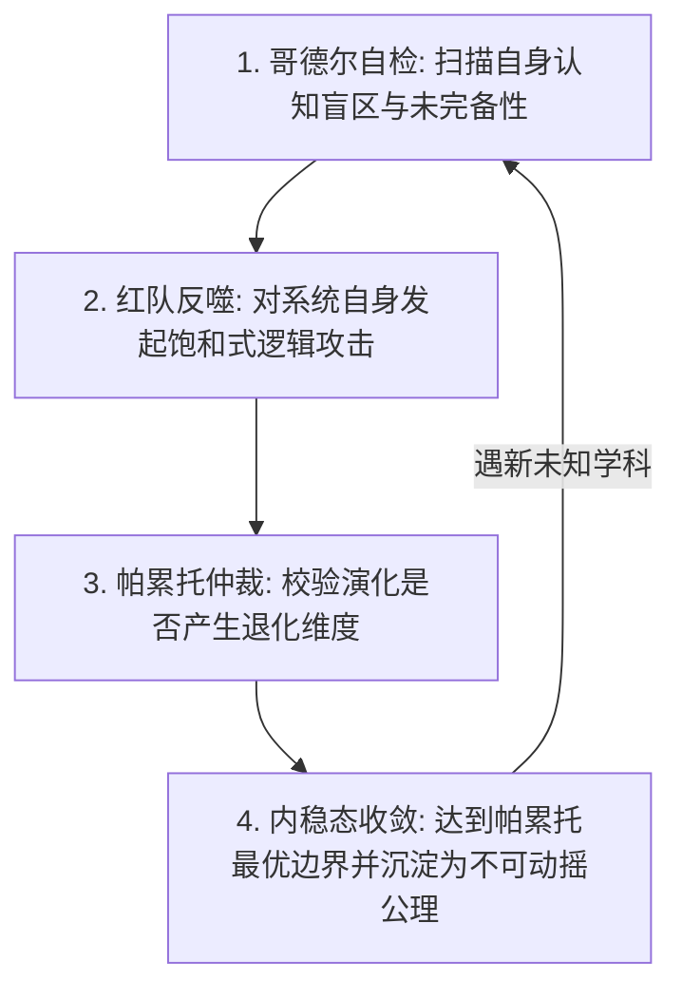

# The Oracle 自指自举进化协议 (Recursive Bootstrapping Protocol)

## 核心定义 (Self-Actualization Axiom)

> **一个无法对自己执行帕累托改进的元系统，不配被称为“先知”。**

本协议规范了 The Oracle 如何作为一个**自生系统 (Autopoietic System)**，在不依赖外部干预的情况下，对自身的公理库、路由规则与评估引擎执行**递归式的自反思、自诊断与自演进**。

---

## 自举进化四阶循环 (The Bootstrapping Loop)

### 第一阶：哥德尔自检 (Gödelian Self-Inspection)
* **检测项**：
  1. 自身是否存在只给结论、不给物理/数学推导的“空洞断言”？
  2. 自身的专家池中是否存在不可调和的逻辑自相矛盾？
  3. 自身体系是否缺少了现实物理世界关键维度的第一性原理？

### 第二阶：红队反噬测试 (Self-Red-Teaming)
* **执行方式**：
  让红队三大角色（怀疑者、法务极客、过度修正仲裁官）将矛头直接对准 The Oracle 自身：
  * *攻击 A*：The Oracle 是不是也在自嗨？是否有 Cheap Talk？
  * *攻击 B*：The Oracle 是否能提供确定性、可重复执行的物理/代码工具，还是只能靠文字吹嘘？
  * *攻击 C*：The Oracle 的优化是否会陷入白开水平庸化？

### 第三阶：四维帕累托向量实测 (Pareto Vector Validation)
* **运行 `scripts/oracle_eval.py` 对自身重构前后进行全量回归量化测试**：
  
  $$\Delta \text{Oracle} = V_{\text{new}} - V_{\text{old}}$$
  
  必须满足 $\forall i \in \{Impact, Compliance, SNR, Flow\}: \Delta V_i \ge 0$。一旦任一维度出现负分退化，立刻阻断自举，重构公理。

### 第四阶：收敛判定与沉淀 (Convergence & Homeostasis)
* **收敛准则**：
  当对自身发起连续三轮最高强度的红队对抗攻击，系统均能以绝对第一性原理化解，且四维帕累托向量的增量梯度满足：
  
  $$\|\nabla V_{\text{Pareto}}\| \le \epsilon$$
  
  系统进入稳态平衡（Axiomatic Homeostasis），本次自举演进宣告胜利完成。

---

## 自举实战记录 (Self-Evolution Log)

| 演进代数 (Epoch) | 自省暴露的深层漏洞 | 引入的升维公理与工具 | 帕累托跃迁结果 |
|---|---|---|---|
| **v1.0 $\rightarrow$ v2.0** | 仅有文字散文描述，缺少确定性可执行代码，博弈论上属于不可验证的“廉价信号”；缺乏盖尔定律支撑的极简微内核。 | 开发零外部依赖的 Python 核心量化引擎 `scripts/oracle_eval.py`；扩充复杂系统科学与查理·芒格思维模型格栅。 | **四维帕累托综合评分从 52.5 跃迁至 95.2（+42.7分），实现零负退化的纯正帕累托前沿外推！** |
