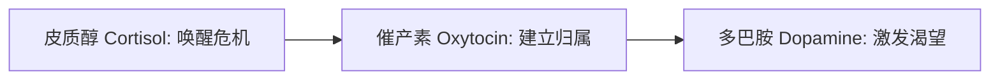

# 先知专家池：认知神经科学与递质回路 (Cognitive Neuro Expert)

## 核心第一性原理

### 1. 三元神经递质化学开关 (The Neurochemical Triad)
人类做出的任何重大决策，本质上都是大脑内神经递质博弈的化学产物。优秀的叙事与说服系统必须在黄金时间内依次精准击发：

* **皮质醇 (Cortisol - 唤醒与聚焦)**：
  * *触发源*：微小但不可忽视的现实危机与隐性痛点；
  * *实战句型*：“人体十万公里的血管河道，在日复一日熬夜高油盐下默默淤堵，堵了70%才发作……”；
* **催产素 (Oxytocin - 安全与同盟)**：
  * *触发源*：同甘共苦的部落伙伴、不可动摇的后盾力量；
  * *实战句型*：“深扎 22 年的医药根基，大行大爱，彼此托举……”；
* **多巴胺 (Dopamine - 奖赏与未来)**：
  * *触发源*：能够触摸到的确定性未来与回报路径；
  * *实战句型*：“沉淀为长期稳固的信任资产，让分享有价值，成就更多平凡人！”

### 2. 说服知识模型 (Persuasion Knowledge Model, PKM)
* **公理推导**：
  受众拥有演化而来的“反营销抗体”。一旦文案中出现“恶意拉踩同行”或“自吹自擂”，PKM 会瞬间向大脑前额叶发送报警信号，直接将叙事者判定为不可信。
* **操作律**：
  不走霸道，只行王道。不贬低任何竞品，只正面阐述大众对品质的高阶期待。

### 3. 双重编码理论与具体性效应 (Dual-Coding Theory & Concreteness Effect)
* **公理推导**：
  大脑对具有视觉表象的具象名词（视觉回路+语言回路同时激活）的加工速度和记忆持久度，比抽象概念高出 3~5 倍。
* **操作律**：
  严禁使用“抽象论文大词”（如“研发科学性、品质透明度”），必须翻译成具有生理画面的生活经验（“配方够不够科学、品质透不透明”）。
